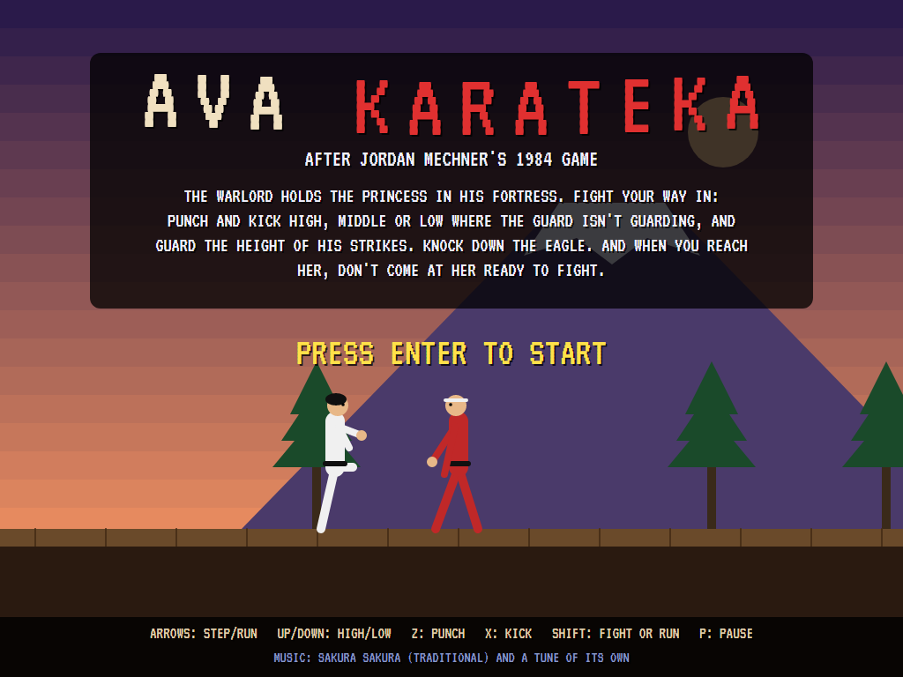
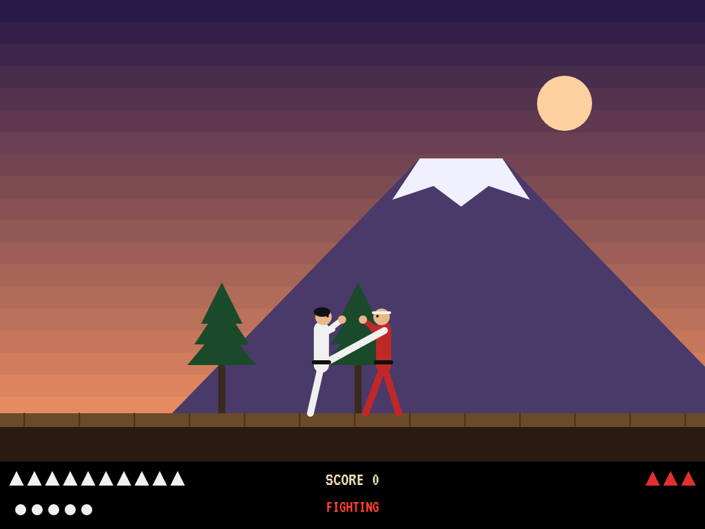
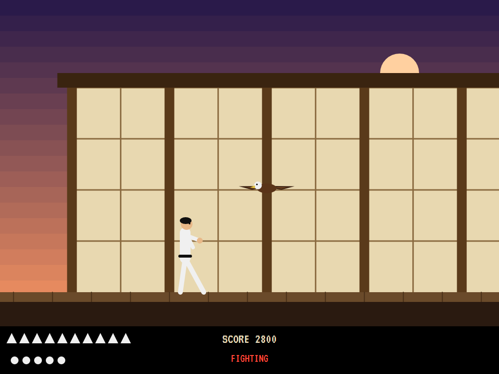
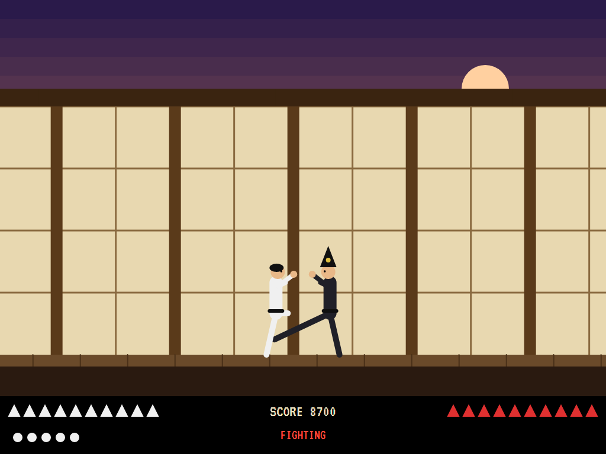
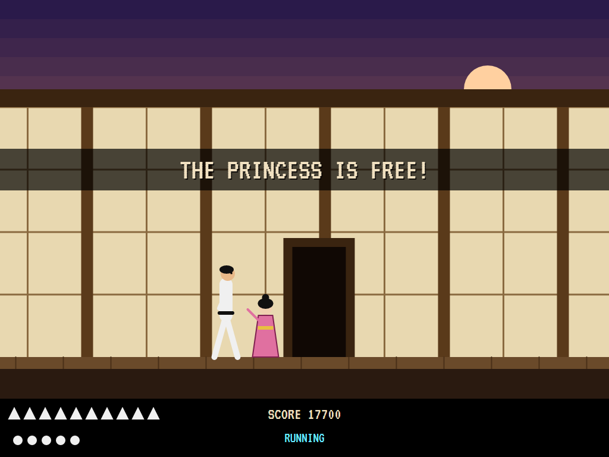
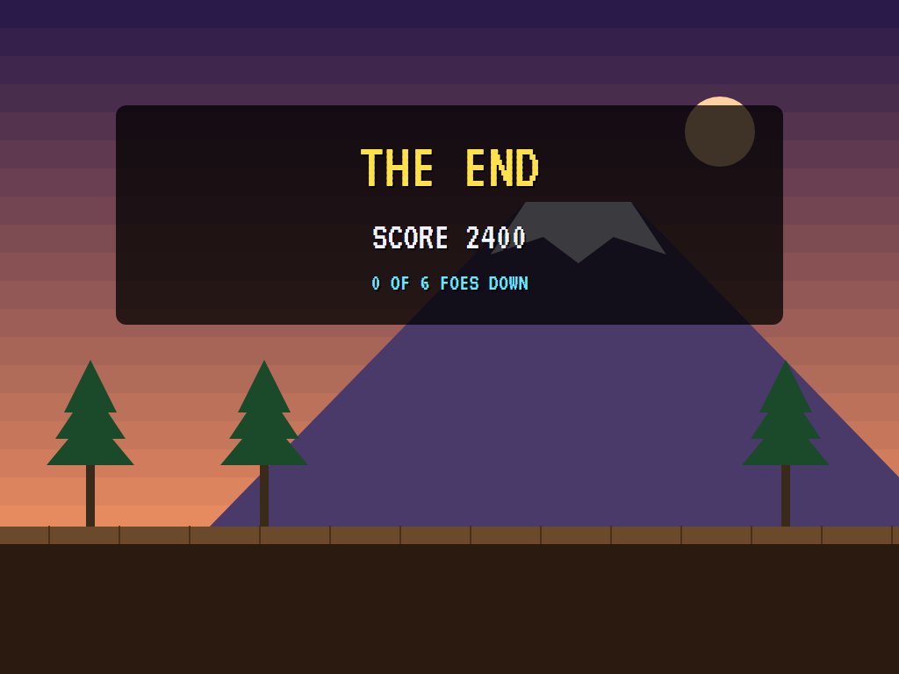
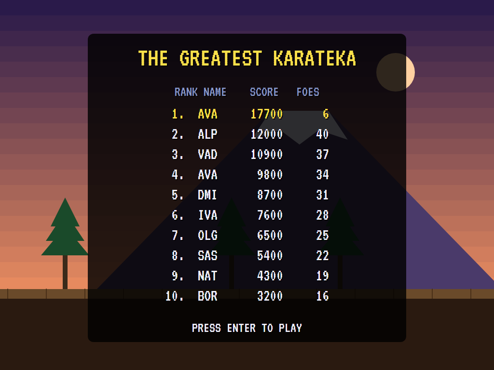

# AVA Karateka

[](https://github.com/Harlock123/AVAKarateka/actions/workflows/build.yml)

A martial-arts adventure in the style of Jordan Mechner's 1984 **Karateka**, built with .NET 10 and Avalonia UI.
The warlord holds the princess in his fortress. Run the cliff path and fight your way through its halls,
guard by guard, to the warlord himself, punching and kicking high, middle or low where each guard isn't guarding.
And when you reach her at last, don't come at her ready to fight.

## Features

- **Two stances.** Running, you cover ground fast, but a guard who catches you running cuts you down with one
  blow. Fighting, you step in and back, and strike: a quick punch, or a kick that reaches further and hurts twice
  as much. Up and down set the height, high, middle or low, of both your strikes and your guard.
- **Strike where he isn't guarding; guard where he strikes.** A blow at the height a fighter is guarding is
  blocked. Each guard bows when you come near, then comes to fight. The guards get stronger and quicker, and
  they learn: the further in you get, the more they guard the height you last struck at.
- **Six foes**: five guards on the way in and the warlord, in black, at the end, more than three times as strong as the
  first. **Two eagles** swoop at your head on the way. Strike high as one comes in, twice, to knock it down.
- **Strength** shows as triangles below the fight: yours on the left, the foe's on the right. It comes back
  while you run between fights. Three lives; a fall puts you back before the guard who beat you, both at full
  strength.
- **Scoring:** 100 a blow (200 a kick), 1,000 a guard, 3,000 for the warlord, 500 an eagle, and 5,000 for the
  princess.
- **The attract mode** shows the computer karateka. It runs between fights and drops into its stance when a foe
  is near. Against a guard, it fights as a karateka is taught: it guards the height of a strike coming, steps in
  when out of reach, and strikes at a height the guard isn't guarding. Against the eagle it tries every act it
  has on a copy of the moment, and takes the one that strikes the bird without being pecked. It reaches the
  princess in a little over a minute without a fall.

## Screenshots

| The title | A kick | The eagle |
|:---------:|:------:|:---------:|
|  |  |  |
| | Middle, under his guard. | Strike high as it comes. |

| The warlord | The princess | Game over |
|:-----------:|:------------:|:---------:|
|  |  |  |

| The greatest karateka |
|:---------------------:|
|  |

The screenshots are made by the tests, which play the game in a real (headless) window; see
[Tests](#tests).

## Download and run

Ready-to-run builds for Windows, macOS and Linux, on both Intel/AMD and ARM, are on the
[Releases page](https://github.com/Harlock123/AVAKarateka/releases/tag/latest). **Latest build** is
rebuilt on every push to `main`. Each download is one self-contained executable: no .NET install is
needed.

| Platform | Archive |
|---|---|
| Windows | `AVAKarateka-win-x64.zip`, `AVAKarateka-win-x86.zip`, `AVAKarateka-win-arm64.zip` |
| macOS | `AVAKarateka-osx-arm64.tar.gz` (Apple silicon), `AVAKarateka-osx-x64.tar.gz` (Intel) |
| Linux | `AVAKarateka-linux-x64.tar.gz`, `AVAKarateka-linux-arm64.tar.gz`, `AVAKarateka-linux-arm.tar.gz` |

```bash
tar -xzf AVAKarateka-linux-x64.tar.gz     # or linux-arm64, linux-arm, osx-arm64, osx-x64
./AVAKarateka
```

On Windows, unzip and run `AVAKarateka.exe`. On macOS, if Gatekeeper refuses to open it, run
`xattr -d com.apple.quarantine AVAKarateka` once. Run with `--no-audio` for silence.

**Sound** comes through OpenAL Soft, built in for every platform. In a virtual machine the game
detects it and uses a larger audio buffer, so the sound doesn't break up.

**Gamepads** use SDL2, which is bundled for Windows, macOS and Intel/AMD Linux. ARM Linux builds need it
installed; without it the keyboard still works:

```bash
sudo apt install libsdl2-dev            # Debian / Ubuntu / Raspberry Pi OS
sudo pacman -S --needed sdl2-compat     # Arch / Omarchy
```

## Controls

| Action | Keyboard | Gamepad |
|---|---|---|
| Start | Enter or 1 (or a punch on the title) | Start |
| Step (fighting) or run (running) | Left/right arrows, or A/D | Left stick / D-pad |
| High / low | Hold up or down (W/S); neither is middle | Stick / D-pad up or down |
| Punch | Z or Ctrl | A |
| Kick | X or Space | B |
| Fight or run | Shift or C | X or a bumper |
| Pause | P or Esc | Start |
| Sound on/off | M | |
| Screenshot | Ctrl+S (to your Pictures folder) | |

On the high-score table, type your initials, or use up/down and Space, then Enter.

## Tests

```bash
dotnet test AVAKarateka.slnx
```

The game runs in fixed 60 Hz steps, so it plays the same at any frame rate. Everything that changes lives in
one world that can be copied. The tests check:

- **The fight:** a strike landing where the guard isn't guarding, and blocked where he is; a kick hurting twice
  as much and reaching further than a punch; guarding the height of a strike; one blow the end for a hero caught
  running; a guard bowing, then coming to fight; points for a guard, and three times as many for the warlord.
- **Strength** coming back between fights; a fall, and back before the guard at full strength.
- **The eagle** pecking a hero who stands there, and struck down by high strikes.
- **The princess:** free if you run to her, and a kick if you come at her ready to fight.
- **The game:** the stance on a press, not a hold; the kiai when a guard goes down; three falls and the end,
  and a high score entered; the demonstration and high scores; starting; the keys.
- **The computer karateka** rescuing the princess without a fall; kicking away without guarding never does.

`tests/AVAKarateka.Tests/PilotProbe.cs` reports how the computer karateka gets on, for tuning
(`KARATEKA_PROBE=1`). It rescues the princess in 72 seconds without a fall. `KARATEKA_PROBE=lazy` runs on and
kicks every half second without guarding: it gets past three of the six foes, falling ten times.

The screenshot tests draw the real screen in a headless window. To refresh the README's pictures:

```bash
KARATEKA_SHOTS=$PWD/Images dotnet test tests/AVAKarateka.Tests --filter ScreenshotTests
```

## Building

```bash
dotnet build AVAKarateka.slnx
dotnet run --project src/AVAKarateka
```

Needs the .NET 10 SDK. The sounds, music and voice are made by `tools/make_sounds.py` (standard-library
Python, with the formant voice in `tools/speech.py`): `python3 tools/make_sounds.py` rewrites
`src/AVAKarateka/Sounds`.

## Project structure

```
AVAKarateka/
├── AVAKarateka.slnx
├── src/AVAKarateka/
│   ├── Engine/
│   │   ├── GameEngine.cs        # States, lives, the rescue, the demonstration
│   │   ├── Sim.cs               # The fighters and their blows, the guards' minds, the eagles, the princess
│   │   ├── World.cs             # Fighters, eagles and everything that changes, kept so it can be copied
│   │   ├── Pilot.cs             # The computer karateka (the demonstration, and the tests)
│   │   ├── HighScoreTable.cs, InitialsEntry.cs
│   │   ├── InputHandler.cs, ControllerManager.cs  # Keys and an SDL2 gamepad
│   │   └── SoundManager.cs      # Effects, music and voice through OpenAL
│   ├── Audio/                   # The OpenAL engine (from the author's AVABand)
│   ├── Views/GameCanvas*.cs     # The mountain, the cliff path and the halls, the fighters, the title
│   └── Sounds/                  # The synthesised effects, music and voice
├── tests/AVAKarateka.Tests/     # Gameplay and screenshot tests
├── tools/make_sounds.py, tools/speech.py
└── Images/                      # Screenshots
```

## About and licence

AVA Karateka © 2026 Lonnie Watson, under the [MIT License](LICENSE).

*Karateka* © 1984 Jordan Mechner; the name *Karateka* belongs to its current owner. AVA Karateka is an
independent, unofficial game in its style. Its graphics, sounds and code are its own; nothing is taken from the
original game's program, graphics or sound. It is not affiliated with or endorsed by any rights holder. The title
music is *Sakura Sakura*, a traditional Japanese song; the march in play is the game's own.
